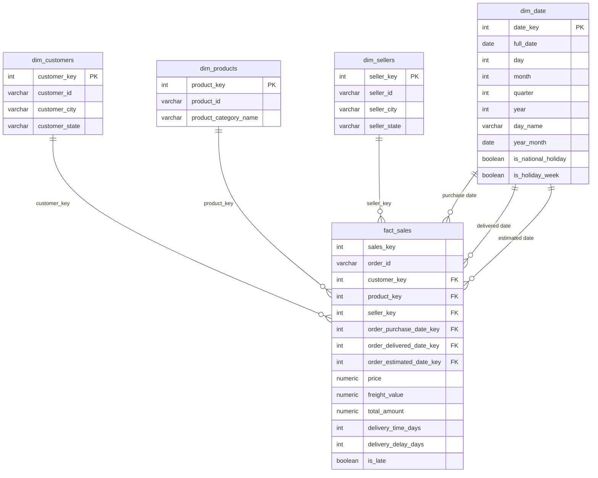
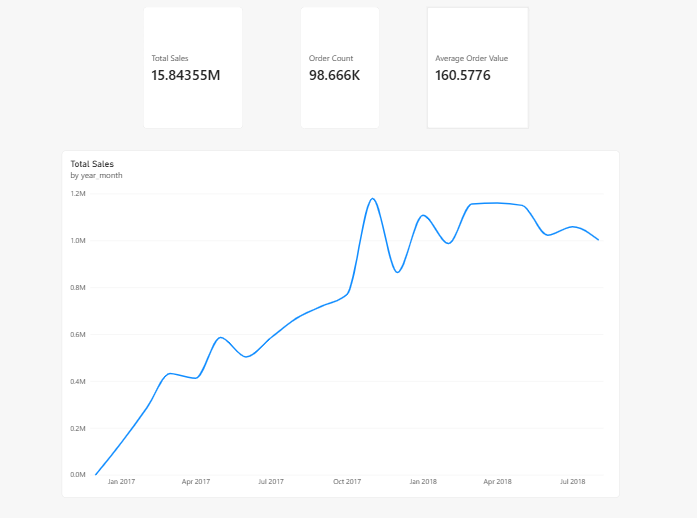
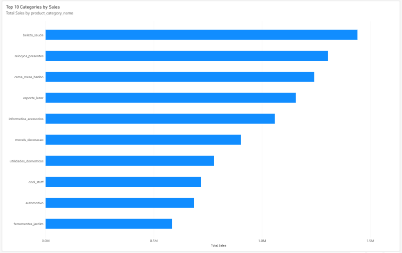
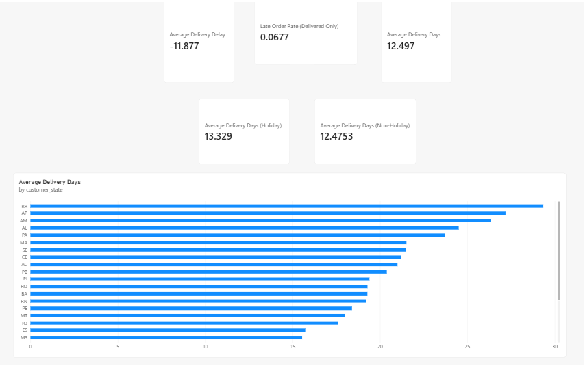

# Ecommerce Sales Dashboard — Project 3 of 3

Dimensional analytics layer (star schema) over Project 1 + 2's `production` schema, refreshed by two tasks inside Project 2's Airflow DAG, plus a Power BI dashboard built on it.

Part of a three-repo portfolio:

| # | Repo | Scope |
|---|---|---|
| 1 | [ecommerce-database-design](https://github.com/Ali-Ahmed-Farag/ecommerce-database-design) | PostgreSQL design + one-time historical seed for Olist (orders, items, payments, reviews, customers…) |
| 2 | [ecommerce-etl-pipeline](https://github.com/Ali-Ahmed-Farag/ecommerce-etl-pipeline) | Airflow ETL pipeline (CSV + API) that upserts into Project 1's `production` schema and refreshes this repo's `analytics` schema |
| 3 | **this repo** | Star schema (`analytics` schema), `fact_sales` materialized view, Power BI manual pack |

## Star schema



`dim_date` is a role-playing dimension: one physical table referenced three times by `fact_sales` (purchase, delivered, estimated), not three separate tables. Grain of `fact_sales` is one row per order line (112,650 rows); it has no `quantity` column because Olist rows already represent single units.

## Materialized View vs physical dimensions (honest justification)

The fact view uses a Materialized View to demonstrate the pattern of decoupling analytical query performance from refresh timing — a controlled, scheduled refresh rather than recomputing complex JOINs on every dashboard open. At the current data volume (~100K rows), a plain View would also perform acceptably; the value here is architectural separation of operational and analytical concerns, not raw necessity. Dimensions are deliberately physical tables, not Materialized Views: a dimension's surrogate key must survive across refreshes (`INSERT … ON CONFLICT` never touches the key column — proven stable by checksum across reruns plus a tamper-and-revert test), while a fact row's `sales_key` is recomputed every refresh and nothing references it across refreshes.

## State-level holidays are out of scope

`dim_date.is_national_holiday` covers national holidays only (`production.holidays WHERE state IS NULL`; all 39 loaded rows have `state` NULL). A single non-state-specific column cannot unambiguously represent a state holiday — resolving that would require a customer/seller-state-aware join, deliberately left as a documented stretch goal rather than built into the core model.

## How Project 3 plugs into Project 2

No separate scheduler. Two tasks run inside Project 2's `ecommerce_etl_pipeline` DAG, in strict order:

```
… upsert_production ─> load_dimension_tables ─> refresh_fact_materialized_view ─> data_quality_check ─> notify_success
```

`load_dimension_tables` executes `sql/load_dimension_tables.sql` (this repo, mounted read-only into the Airflow container) in one transaction: calendar insert, full holiday-flag recompute, customer/product/seller upserts. `refresh_fact_materialized_view` runs `REFRESH MATERIALIZED VIEW analytics.fact_sales`. A dimension-load failure blocks the fact refresh through the DAG edges. Current contents: dim_date 860 rows (2016-08-05…2018-12-12), dim_customers 99,441, dim_products 32,951, dim_sellers 3,095, fact_sales 112,650 rows; `production.holidays` 39 rows (13 per year 2016–2018). Thirty national-holiday dates fall inside the calendar; the other 9 (2016-01-01, 2016-02-08, 2016-02-09, 2016-03-25, 2016-03-27, 2016-04-21, 2016-05-01, 2016-05-26, 2018-12-25) fall outside the order-span ±30-day range by design.

## Orders without items, and customers

775 production orders have zero line items, so `fact_sales` covers 98,666 distinct orders versus 99,441 in `production.orders`. Power BI Order Count matches the fact grain (98,666), not `production.orders`. `dim_customers` holds 99,441 rows — Olist `customer_id` is effectively per-order, so a distinct-customer count is not meaningful and no such visual is built.

## Holiday comparison is descriptive, not causal

Delivered orders with a purchase date on a national holiday (2,485 orders, average delivery 13.33 days) versus other delivered orders (93,991 orders, 12.48 days). The gap describes the two groups; it does not prove holidays cause slower delivery.

## How to run

```bash
# 1. dimension tables (once; rerunnable)
Get-Content sql\analytics_dimension_tables_ddl.sql | docker exec -i ecommerce_postgres psql -U postgres -d ecommerce

# 2. dimension load (rerunnable; normally via the DAG task)
Get-Content sql\load_dimension_tables.sql | docker exec -i ecommerce_postgres psql -U postgres -d ecommerce --single-transaction

# 3. fact view (normally via the DAG task)
Get-Content sql\analytics_fact_materialized_view.sql | docker exec -i ecommerce_postgres psql -U postgres -d ecommerce --single-transaction

# 4. read-only analyst role (password lives in .env, gitignored)
Get-Content sql\create_powerbi_role.sql | docker exec -i ecommerce_postgres psql -U postgres -d ecommerce
```

Power BI connects as `powerbi_reader` (SELECT on `analytics` only) per `docs/powerbi_manual_steps.md`. Reference values for checking the dashboard are in `docs/powerbi_reference_values.md`. 9 measures were verified in Power BI against the SQL reference values in docs/powerbi_reference_values.md (Total Sales, Order Count, AOV, Avg Delivery Days, Avg Delivery Delay, Late Order Rate, Late Order Rate (Delivered Only), Holiday Avg Delivery Days, Non-Holiday Avg Delivery Days). 3 measures (Orders Delivered On This Date, Total Sales LM, MoM Growth %) were verified only by cross-column comparison, not against a SQL reference value.

## Dashboard screenshots


Charted range Oct 2016 - Aug 2018: Sep 2016 and Sep 2018 are partial tail months in the Olist data (Sep 2018 has 1 order).



The `.pbix` is committed in this repo: [powerbi/sales_dashboard.pbix](powerbi/sales_dashboard.pbix).
